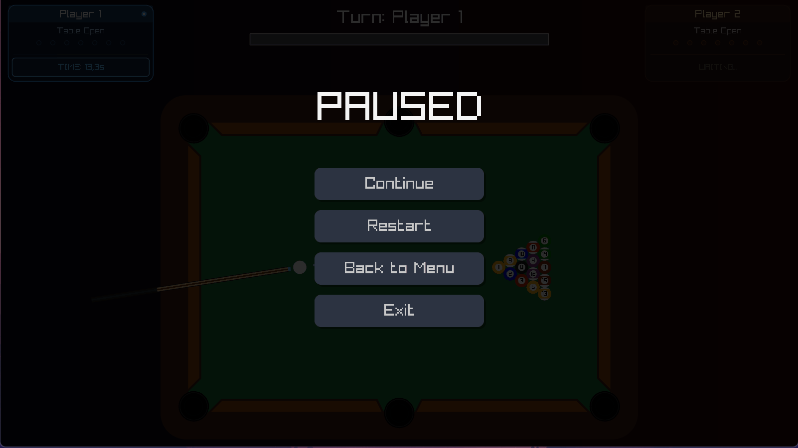
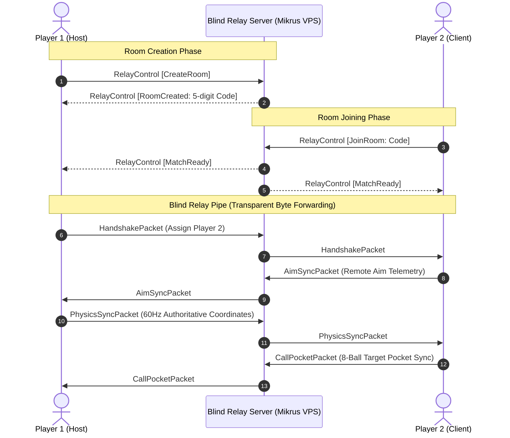
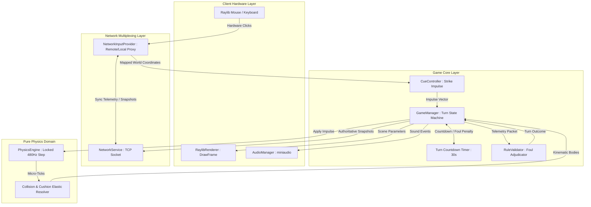

<div align="center">

# 🎱 2D Billiards Game

[](https://dotnet.microsoft.com/)
[](https://docs.microsoft.com/en-us/dotnet/csharp/)
[](https://github.com/ChrisDill/Raylib-cs)
[](https://learn.microsoft.com/en-us/dotnet/architecture/modern-web-apps-azure/common-web-application-architectures)
[](https://github.com/zephir-x/billards-game)
[](https://ghcr.io/zephir-x/billards-game-relay)
[](https://xunit.net/)

*A highly optimized, custom-built 2D physics billiards engine written entirely from scratch in C# 13. Engineered with strict Domain-Driven Design (DDD) principles, blazingly fast Raylib graphics, and seamless online 1v1 multiplayer powered by a dedicated high-throughput Blind Relay Server.*

</div>

---

<details>
<summary>📖 Table of Contents</summary>

- [About the Project](#-about-the-project)
- [For Gamers (How to Play)](#-for-gamers-how-to-play)
- [Multiplayer & Online Architecture](#-multiplayer--online-architecture)
- [Key Features](#-key-features)
- [Architectural Marvels (Tech Deep Dive)](#-architectural-marvels-tech-deep-dive)
- [Algorithm Data Flow & Engine Loop](#-algorithm-data-flow--engine-loop)
- [Technology Stack](#-technology-stack)
- [Project Structure](#-project-structure)
- [Relay Server Deployment (Docker & Mikrus)](#-relay-server-deployment-docker--mikrus)
- [Getting Started (Local Development)](#-getting-started-local-development)
- [Author / Contact](#-author--contact)

</details>

---

## 💡 About the Project

**2D Billiards - Zephir Edition** is a pool simulator showcasing how to build a proprietary, deterministic physics engine from the ground up without relying on heavy third-party frameworks like Box2D or Unity. 

It implements official 8-Ball rules, dynamic kinetic force transfers, accurate ball-to-cushion rebounding, turn adjudication timeouts, and robust online multiplayer strictly decoupled from the presentation layer using **Clean Architecture** and **Domain-Driven Design (DDD)**. The visual presentation and spatial audio are powered directly by native C-bindings via Raylib-cs for minimum latency.

---

<div align="center">
  
  <p><i>🎱 Accurate momentum transfer, real-time kinetic visual mapping, and online synchronization.</i></p>
</div>

---

## 🎮 For Gamers (How to Play)

You don't need any programming knowledge or external runtimes to play the game!

### Quick Start
1. **Download:** Go to the [Releases](../../releases) tab of this repository.
2. **Extract:** Download the latest `2D_Billiards_Game_v1.2.0.zip` (or `BilliardsGame-win-x64.zip`) and extract its contents anywhere on your PC.
3. **Play:** Double-click `BilliardsGame.exe` and you are ready to play!

### Game Modes
* **Play Online (1v1 Multiplayer):** 
  * **Host Match:** Generates a unique 5-digit room code (e.g. `48192`) through our dedicated relay server. Share this code with a friend!
  * **Join Match:** Enter your friend's 5-digit room code and jump straight into the match with real-time aim, pocket calling, and physics synchronization.
* **Training (Hotseat Mode):** Play offline on a single screen to practice trick shots, bank shots, and break angles.

### Controls & Rules
* **Aiming:** Move your cursor around the cue ball. An intelligent aim-assist dynamically visualizes trajectory guides proportional to your strike power (only visible on your turn).
* **Shooting:** Click and hold the **Left Mouse Button** to pull back and charge your cue stick. Release to strike!
* **Overheat Penalty:** Holding the charge too long (over 1.0s) triggers an overheat penalty with a mandatory cooling animation preventing panic strikes.
* **Global Turn Countdown Timer:** Each player has strictly **30.0 seconds** per turn. An integrated timer gauge pulses red under 5 seconds with an acoustic tick warning. If the timer reaches zero, a **Time Out Foul** is awarded and your opponent receives **Ball in Hand**.
* **Ball In Hand:** Following any foul (scratch, timeout, or illegal hit), you can pick up the white cue ball and place it anywhere on the table (with live ghost preview for both players).
* **Calling Pocket (8-Ball):** When attempting the match-winning 8-Ball pot, cleanly designate the target pocket with a single click, synchronized in real time to the opponent's screen.
* **8-Ball Rules:** Standard official rules apply. Claim your assigned group (Solids or Stripes), pocket all balls of your group, and pot the 8-Ball Black cleanly into your called pocket to win.

---

## 🌐 Multiplayer & Online Architecture

Online play is engineered around an **Authoritative Host + Blind Relay Server** architecture, ensuring low latency, zero NAT-traversal friction, and ironclad stability:



### Key Network Design Pillars:
* **Dedicated High-Throughput Blind Relay:** The relay server (`Server/BilliardsGame.RelayServer`) acts as an in-memory pipeline. Once sockets are paired, bytes are piped transparently without JSON serialization overhead, minimizing CPU usage and latency.
* **Authoritative Physics Host:** Host (Player 1) executes the deterministic 480Hz physics simulation and streams 60Hz coordinate snapshots (`PhysicsSyncPacket`) to Player 2 to completely eliminate synchronization drift.
* **Authoritative Shot Execution:** Shots charged on the client trigger an authoritative stroke execution on the host via `ShotExecutionPacket`, preserving strict physics consistency.
* **Thread-Safe Binary Framing:** All packets are encoded with Big-Endian length headers and dispatched via synchronized socket writes (`_sendLock`) to prevent stream interleaving.
* **Self-Healing TCP Buffering:** Inbound streams dynamically expand their memory capacity up to 1 MB to seamlessly handle fragmented packet frames without stream desynchronization.

---

## 🚀 Key Features

| Feature | Description |
| :--- | :--- |
| **Custom Kinematics Engine (480Hz)** | Built purely in C# without Box2D. Features sub-step micro-stepping (`dt = 1/480s`) to prevent tunneling, accurate restitution matrices, and realistic momentum transfers. |
| **Online 1v1 Peer-to-Peer Relay** | Play over the internet using quick 5-digit room codes routed through our lightweight production relay server with zero port-forwarding requirements for players. |
| **Glassmorphism HUD & Integrated Timer** | Sleek corner player cards with individual sapphire/amber themes, 7-dot pocketing progress trackers, and an integrated turn timer with acoustic alerts. |
| **Strict 8-Ball Referee State Machine** | Intelligent rule validation evaluating first-contact legality, rail contacts, pocket drops, scratch fouls, called pocket validation, and winner determination. |
| **Authoritative Remote Aim & Pocket Sync** | Live opponent cursor preview during Ball-in-Hand, visual cue retraction without revealing dotted aim-assist lines, and synchronized 8-ball pocket calls. |
| **Pure Raylib Hardware Integration** | Procedural vector drawing for balls, felt, cushions, and dynamic icons (generated purely in RAM and bound to Windows Shell). Interpolated 144Hz+ rendering. |
| **100% Domain Test Coverage** | 76 comprehensive unit tests covering physics math, cue controllers, referee decision branches, and network packet framing. |

---

## 🏛️ Architectural Marvels (Tech Deep Dive)

This codebase serves as an enterprise blueprint for architecting scalable, easily testable game engines:

* **🛡️ Clean Architecture & DDD:** Strict boundary segregation isolating Domain logic (`Core/`, `Physics/`, `Network/`) from Infrastructure (`App/`). The UI consumes read-only data contracts (`ISceneParameters`) and dispatches commands via loose delegates.
* **⚡ Production Relay Microservice:** `BilliardsGame.RelayServer` runs as an ultra-lightweight Alpine container (~50MB) with strict resource limits (`cpus: 0.5`, `memory: 64M`) supporting up to 100 concurrent rooms with automatic 3-minute lobby idle timeouts.
* **🧠 Deterministic Context Evaluator:** `RuleValidator.cs` functions as a pure functional pipeline receiving immutable telemetry and yielding exact match-state transitions.
* **⚙️ Hardware-Agnostic Timing:** A decoupled spinlock accumulator guarantees fixed physics ticks (`1/480s`) regardless of display frame-rates, paired with scalar linear interpolation (`alpha = accumulator / dt`) for buttery smooth 144Hz+ monitors.

---

## 🔄 Algorithm Data Flow & Engine Loop



---

## 💻 Technology Stack

| Layer | Technologies & Tools |
| :--- | :--- |
| **Language & Runtime** | C# 13, .NET 9.0 SDK, MSBuild |
| **Graphics & Audio** | Raylib-cs (OpenGL bindings, miniaudio native backend) |
| **Network Protocol** | Custom TCP Length-Prefixed Framing, System.Text.Json Contracts |
| **Server & Container** | .NET 9 Alpine Linux, Docker Compose, GitHub Actions (GHCR) |
| **Architecture** | Clean Architecture, Domain-Driven Design (DDD), Composition Root DI |
| **Automated Testing** | xUnit, Moq (76 Automated Domain, Physics & Network Tests) |
| **Distribution** | Windows Native Self-Contained / Single-File Publishing (`build_release.ps1`) |

---

## 📁 Project Structure

<details>
<summary><strong>Click to expand the Architecture Tree</strong></summary>

```text
billards-game/
├── .github/workflows/
│   └── docker-publish.yml             # Builds & publishes Relay Server to GHCR
├── App/                               # Presentation & Hardware Composition Root
│   ├── RaylibRenderer.cs              # Full multi-view lobby, glassmorphism HUD & table rendering
│   ├── RaylibInputProvider.cs         # Raw mouse/keyboard hardware adapter
│   ├── SceneParameters.cs             # UI presentation data contract adapter
│   ├── AudioManager.cs                # High-fidelity miniaudio BGM/SFX pipeline
│   └── Program.cs                     # Composition Root wiring all subsystems
├── Core/                              # Match Rules & Domain State Machine
│   ├── GameManager.cs                 # Match supervisor, turn states & 30s timer
│   ├── CueController.cs               # Aim vector calculations, shot power charging & overheat
│   └── RuleValidator.cs               # Pure functional 8-ball referee evaluator
├── Physics/                           # High-Performance Kinematics Simulator
│   ├── PhysicsEngine.cs               # Math loop evaluating 480Hz micro-steps
│   ├── Ball.cs / Cushion.cs           # Kinematic circular bodies & static segment cushions
│   └── Pocket.cs                      # Table hole boundary detection
├── Network/                           # Online Multiplayer Subsystem
│   ├── Abstractions/                  # INetworkService contracts
│   ├── Services/                      # NetworkService (TCP framing, socket threads)
│   ├── Protocol/                      # Data contracts (Aim, PhysicsSync, CallPocket, Handshake, etc.)
│   └── Input/                         # NetworkInputProvider (Remote vs. Local multiplexer)
├── Server/
│   └── BilliardsGame.RelayServer/     # Standalone lightweight 5-digit room pairing demon
├── Interfaces/                        # Shared models, enumerations and contracts
├── Assets/                            # Demo GIFs, features illustrations & audio assets (9 SFX, 2 BGM)
└── tests/                             # Comprehensive xUnit automated test suites (76 total)
    ├── BilliardsGame.Core.Tests       # 36 tests: turn transitions, timers, overheats & referee
    ├── BilliardsGame.Physics.Tests    # 17 tests: momentum transfer & cushion rebound
    └── BilliardsGame.Network.Tests    # 23 tests: TCP framing, serialization & buffers
```

</details>

---

## 🐳 Relay Server Deployment (Docker & Mikrus)

The production relay server runs as a standalone Docker container. It requires zero database dependencies and is fully automated via GitHub Actions (`ghcr.io/zephir-x/billards-game-relay:latest`).

### Running via Docker Compose
Create a `docker-compose.yml` file on your server (e.g. VPS / Mikrus):

```yaml
services:
  billiards-relay:
    image: ghcr.io/zephir-x/billards-game-relay:latest
    container_name: billiards_relay
    restart: unless-stopped
    ports:
      - "20117:7777"
    environment:
      - RELAY_PORT=7777
      - DOTNET_gcServer=0
    deploy:
      resources:
        limits:
          cpus: "0.50"
          memory: 64M
    logging:
      driver: "json-file"
      options:
        max-size: "10m"
        max-file: "3"
```

Start the service:
```bash
docker compose pull
docker compose up -d
```

---

## 🛠️ Getting Started (Local Development)

### 1. Clone the repository:
```bash
git clone https://github.com/zephir-x/billards-game.git
cd billards-game
```

### 2. Build the solution (.NET 9 required)
```bash
dotnet build BilliardsGame.sln
```

### 3. Run the Game Engine
```bash
dotnet run --project App/BilliardsGame.App.csproj
```

### 4. Run the Full Test Suite
```bash
dotnet test
```

### 5. Build Standalone Release Package (.EXE & ZIP)
To build the complete self-contained release package with all audio and native binaries:
```powershell
powershell -ExecutionPolicy Bypass -File .\build_release.ps1
```
The output will be created in `dist/BilliardsGame-win-x64/` and compressed into `dist/BilliardsGame-win-x64.zip`.

---

## 👨‍💻 Author / Contact

Engineered by **Kacper**.

[](https://www.linkedin.com/in/kacper-gumulak-dev)
[](https://github.com/zephir-x)
